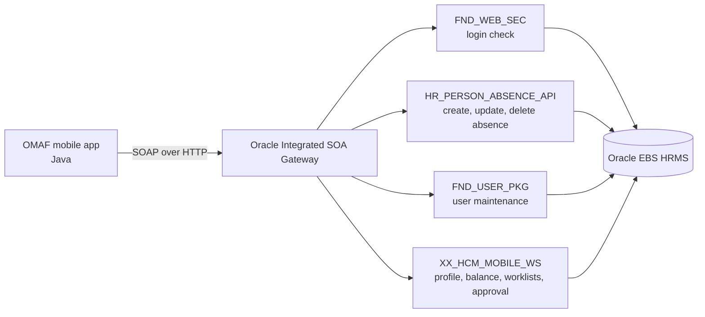

# Human-Capital-Mobile-App

These are the integration files for a proof of concept of a Human Capital mobile app for the Organization, built in 2015. Employees could use the app to sign in, view their profile, request vacation, track requests and check their vacation balance. Managers could approve or reject requests. All of it ran against Oracle E-Business Suite (EBS) HRMS.

The app was built with Oracle Mobile Application Framework (OMAF) in Java. It talked to EBS through SOAP web services, which Oracle's Integrated SOA Gateway generated from standard and custom PL/SQL APIs.

This repository holds the back-end integration work: the custom PL/SQL package behind the app's screens, a script that registers it as a web service, the SoapUI test project, sample requests for each service, and a step-by-step guide to publishing a custom PL/SQL package as a web service. The OMAF app source isn't included.

## Repository layout

```
Human-Capital-Mobile-App/
├── Create Custom WS.docx                    # Guide: publish a custom PL/SQL API as a SOAP service
├── plsql/
│   ├── XX_HCM_MOBILE_WS.pls                 # Package spec with Integration Repository annotations
│   ├── XX_HCM_MOBILE_WS.plb                 # Package body
│   └── register_irep.sh                     # Compiles and registers the package (the guide's "Session Action Script")
└── SOAPUI webservices/
    ├── apps-vis-soapui-project.xml          # SoapUI project with the three standard service bindings
    ├── VALIDATE_LOGIN/                      # Standard: sign-in check
    │   ├── URL.txt                          # Endpoint
    │   ├── request.xml                      # Sample request
    │   └── response.xml                     # Sample response
    ├── CREATE_ABSENCE_API/                  # Standard: create a vacation request
    ├── GET_EMPLOYEE_PROFILE/                # Custom services from XX_HCM_MOBILE_WS,
    ├── GET_ABSENCE_TYPES/                   # each with URL.txt and request.xml
    ├── GET_VACATION_BALANCE/
    ├── GET_EMPLOYEE_ABSENCES/
    ├── GET_MANAGER_WORKLIST/
    └── DECIDE_ABSENCE/
```

## Architecture



Each SOAP call carries an `SOAHeader` that sets the EBS session context: responsibility, application, security group, NLS language and org ID. For example, the login check runs as `SYSTEM_ADMINISTRATOR` / `SYSADMIN`, and the absence API runs as an HRMS manager responsibility in the `PER` application.

## Services

| Binding | Operations in the SoapUI project | Used for |
|---|---|---|
| `FND_WEB_SEC_Binding` | `VALIDATE_LOGIN` | Signing in with EBS user name and password |
| `HR_PERSON_ABSENCE_API_Binding` | `CREATE_PERSON_ABSENCE`, `UPDATE_PERSON_ABSENCE`, `DELETE_PERSON_ABSENCE` | Submitting and managing vacation requests |
| `FND_USER_PKG_Binding` | `VALIDATE_USER_NAME`, `CHANGE_USER_NAME`, `LDAP_WRAPPER_CREATE_USER`, `LDAP_WRAPPER_UPDATE_USER`, `DERIVE_PERSON_PARTY_ID` and 7 more | User account checks and maintenance |

The custom package `XX_HCM_MOBILE_WS` covers the screens the standard APIs don't:

| Operation | App screen | What it returns or does |
|---|---|---|
| `GET_EMPLOYEE_PROFILE` | My Profile | Name, employee number, email, work phone, department, position, job and supervisor for an EBS user |
| `GET_ABSENCE_TYPES` | New Vacation | Active absence types of the business group, for the type picker |
| `GET_VACATION_BALANCE` | Vacation Balance | Net entitlement from the employee's vacation accrual plan, through `PER_ACCRUAL_CALC_FUNCTIONS.GET_NET_ACCRUAL` |
| `GET_EMPLOYEE_ABSENCES` | My Vacations | The employee's requests with their status, newest first |
| `GET_MANAGER_WORKLIST` | Approval work list | Pending requests of the manager's direct reports |
| `DECIDE_ABSENCE` | Vacation View | Approves or rejects a pending request through `HR_PERSON_ABSENCE_API.UPDATE_PERSON_ABSENCE`, after checking the caller is the employee's supervisor |

Every operation returns `X_RETURN_STATUS` (`S` or `E`) and `X_MESSAGE`, so the app can show a clear error.

### Approval status

EBS doesn't track approval on an absence created through the API, so the package keeps the status in `ATTRIBUTE1` of the absence descriptive flexfield: `PENDING`, `APPROVED` or `REJECTED`. The app sends `P_ATTRIBUTE1 = PENDING` when it creates a request (see `CREATE_ABSENCE_API/request.xml`), and `DECIDE_ABSENCE` changes it. Requests without a status, such as ones keyed in by HR, count as approved.

If `ATTRIBUTE1` is already used on your instance, pick a free segment and change it in the package body and in the create request.

### Login

`VALIDATE_LOGIN` takes `P_USER` and `P_PWD` and returns `Y` or `N`:

```xml
<OutputParameters>
   <VALIDATE_LOGIN>Y</VALIDATE_LOGIN>
</OutputParameters>
```

### Create a vacation request

`CREATE_PERSON_ABSENCE` takes the person, business group, absence type, start and end dates, and number of days:

```xml
<cre:P_VALIDATE>0</cre:P_VALIDATE>
<cre:P_EFFECTIVE_DATE>2015-03-02T00:00:00</cre:P_EFFECTIVE_DATE>
<cre:P_PERSON_ID>18701</cre:P_PERSON_ID>
<cre:P_BUSINESS_GROUP_ID>5461</cre:P_BUSINESS_GROUP_ID>
<cre:P_ABSENCE_ATTENDANCE_TYPE_ID>932</cre:P_ABSENCE_ATTENDANCE_TYPE_ID>
<cre:P_DATE_START>2015-03-02T00:00:00</cre:P_DATE_START>
<cre:P_DATE_END>2015-03-02T00:00:00</cre:P_DATE_END>
<cre:P_ABSENCE_DAYS>1</cre:P_ABSENCE_DAYS>
```

The response returns the new `P_ABSENCE_ATTENDANCE_ID` and object version number. It also returns the API's warning flags, such as overlapping absences or exceeding the PTO entitlement. The app can show those flags to the employee.

## Publishing a custom PL/SQL API as a web service

`Create Custom WS.docx` covers the steps with screenshots. In short:

1. Write the PL/SQL package and add the annotation comments the Integration Repository needs.
2. Register the package in the Integration Repository and load it.
3. Open the package in Integrated SOA Gateway, select the procedure and click Create Grant.
4. Click Generate WSDL, choose Username Token authentication and click Deploy.
5. Open View WSDL and save it as an XML file.
6. In SoapUI, create a new project from that WSDL and test the call.
7. If the call fails, check the SOA Monitor for details. A known fix is to download the generated WSDL from the server, remove the `IRepOverloadSeq` line, upload it back to the same location and call again.

## Installing the custom package

1. Copy the `plsql` folder to the EBS application tier.
2. Source the EBS environment file and run `./register_irep.sh`. It asks for the APPS password, compiles the package, parses its annotations with `irep_parser.pl` and uploads the result with `FNDLOAD`.
3. Log in as SYSADMIN, open Integrated SOA Gateway > Integration Repository and find `XX_HCM_MOBILE_WS` under Human Resources Suite > PL/SQL.
4. Follow steps 3 to 6 above to grant, generate, deploy and test each operation.

The package hasn't been compiled against a live instance from this repository, so run it on a test or Vision instance first.

## Testing with SoapUI

1. Install [SoapUI](https://www.soapui.org/) 5.x.
2. Import `SOAPUI webservices/apps-vis-soapui-project.xml`.
3. Change the endpoint host in each binding to your EBS instance. The samples point to an Oracle Vision demo instance on port 8000.
4. Set the WS-Security username token on the request to an EBS user who has the right responsibility.
5. Run the request and compare it with the sample response in the matching folder.

For the custom operations, add the WSDL you deployed for `XX_HCM_MOBILE_WS` to the SoapUI project and paste the sample requests from the matching folders.

## Tech stack

Oracle E-Business Suite R12 HRMS, Oracle Integrated SOA Gateway, PL/SQL, SOAP and XML, SoapUI, Java and Oracle Mobile Application Framework.

## Notes

- The guide refers to a `Session Action Script.txt` file for registering packages. `plsql/register_irep.sh` does the same job.
- The sample requests use Oracle Vision demo data and credentials. Never commit real EBS user names, passwords or employee IDs.

## Outcome

The proof of concept covered sign-in, the employee profile, new vacation requests, the request worklist, the manager's approve or reject view and the vacation balance. The company was awarded the full HCM mobile app project after it.
